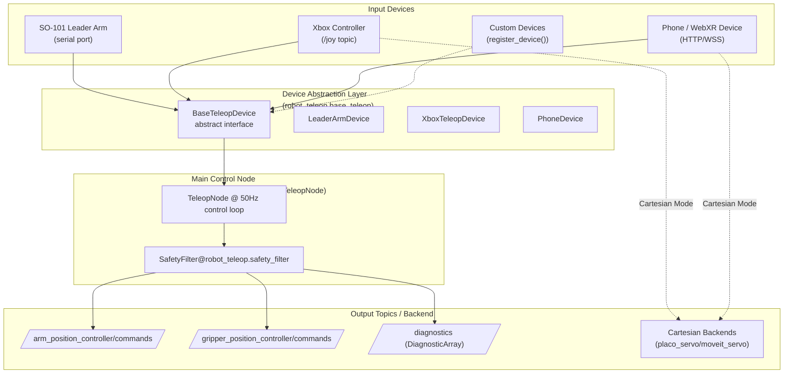
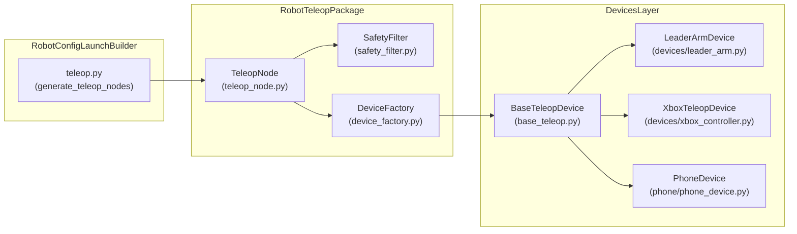

# 遥操作

<details>
<summary>相关源码文件</summary>

以下文件被用作生成此 wiki 页面的上下文：

- [src/robot_config/robot_config/launch_builders/teleop.py](https://atomgit.com/openeuler/IB_Robot/blob/openEuler-26.09/src/robot_config/robot_config/launch_builders/teleop.py)
- [src/robot_moveit/config/so101_servo.yaml](https://atomgit.com/openeuler/IB_Robot/blob/openEuler-26.09/src/robot_moveit/config/so101_servo.yaml)
- [src/robot_teleop/README.en.md](https://atomgit.com/openeuler/IB_Robot/blob/openEuler-26.09/src/robot_teleop/README.en.md)
- [src/robot_teleop/README.md](https://atomgit.com/openeuler/IB_Robot/blob/openEuler-26.09/src/robot_teleop/README.md)
- [src/robot_teleop/package.xml](https://atomgit.com/openeuler/IB_Robot/blob/openEuler-26.09/src/robot_teleop/package.xml)
- [src/robot_teleop/robot_teleop/__init__.py](https://atomgit.com/openeuler/IB_Robot/blob/openEuler-26.09/src/robot_teleop/robot_teleop/__init__.py)
- [src/robot_teleop/robot_teleop/base_teleop.py](https://atomgit.com/openeuler/IB_Robot/blob/openEuler-26.09/src/robot_teleop/robot_teleop/base_teleop.py)
- [src/robot_teleop/robot_teleop/device_factory.py](https://atomgit.com/openeuler/IB_Robot/blob/openEuler-26.09/src/robot_teleop/robot_teleop/device_factory.py)
- [src/robot_teleop/robot_teleop/devices/leader_arm.py](https://atomgit.com/openeuler/IB_Robot/blob/openEuler-26.09/src/robot_teleop/robot_teleop/devices/leader_arm.py)
- [src/robot_teleop/robot_teleop/devices/xbox_controller.py](https://atomgit.com/openeuler/IB_Robot/blob/openEuler-26.09/src/robot_teleop/robot_teleop/devices/xbox_controller.py)
- [src/robot_teleop/robot_teleop/phone/__init__.py](https://atomgit.com/openeuler/IB_Robot/blob/openEuler-26.09/src/robot_teleop/robot_teleop/phone/__init__.py)
- [src/robot_teleop/robot_teleop/phone/config_phone.py](https://atomgit.com/openeuler/IB_Robot/blob/openEuler-26.09/src/robot_teleop/robot_teleop/phone/config_phone.py)
- [src/robot_teleop/robot_teleop/phone/phone_device.py](https://atomgit.com/openeuler/IB_Robot/blob/openEuler-26.09/src/robot_teleop/robot_teleop/phone/phone_device.py)
- [src/robot_teleop/robot_teleop/teleop_node.py](https://atomgit.com/openeuler/IB_Robot/blob/openEuler-26.09/src/robot_teleop/robot_teleop/teleop_node.py)
- [src/robot_teleop/setup.py](https://atomgit.com/openeuler/IB_Robot/blob/openEuler-26.09/src/robot_teleop/setup.py)
- [src/robot_teleop/test/test_leader_arm.py](https://atomgit.com/openeuler/IB_Robot/blob/openEuler-26.09/src/robot_teleop/test/test_leader_arm.py)
- [src/so101_hardware/scripts/calibrate_arm.py](https://atomgit.com/openeuler/IB_Robot/blob/openEuler-26.09/src/so101_hardware/scripts/calibrate_arm.py)

</details>

本节描述托管于 <https://github.com/wuxiaoqiang12/RoboFrame_stable> 的 RoboFrame stable 代码库中的遥操作子系统。遥操作功能使人类操作者能够通过物理设备（如 SO-101 主臂、Xbox 手柄及支持 WebXR 的手机）实时控制机器人。设计强调零延迟控制、安全强制、模块化设备抽象，以及与 ROS 2 robot_config launch 系统的无缝集成。

---

## 概述

遥操作系统通过将人类控制命令翻译为机器人关节目标位置、强制关节安全限位并发布到控制器话题，将各类输入设备桥接到 ROS 2 机器人控制器。系统通过实现公共接口的清晰**设备抽象层**支持多种设备类型，使单个 ROS 2 节点（`TeleopNode`）能够编排带安全保证的多设备遥操作。

关键特性包括：

- 以 50 Hz（默认）运行的实时控制循环
- 基于工厂的主臂、Xbox 手柄与手机/WebXR 设备实例化
- 通过逐关节强制限位进行安全过滤，避免不安全命令
- 为兼容设备（Xbox 笛卡尔模式、手机）支持笛卡尔后端（`placo_servo`、`moveit_servo`）
- 与 robot_config 的 launch 系统集成，实现自动配置与生命周期管理
- 诊断与紧急停止接口，保证运行时健壮性

遥操作子系统主要位于 `src/robot_teleop/robot_teleop/` 下的 ROS 包 `robot_teleop` 中，并通过 `src/robot_config/robot_config/launch_builders/teleop.py` 与机器人配置系统深度集成。

---

## 架构与数据流

遥操作架构遵循分层设计，下文详述其与代码模块和类的显式映射。



**图例：**

- **输入设备**：物理遥操作设备，包括 SO-101 主臂（串口）、Xbox 手柄（监听 `/joy` 话题）、手机/WebXR 设备（HTTP/WSS）。
- **设备层**：抽象基接口 `BaseTeleopDevice` 定义连接、命令读取与断开方法。具体实现提供设备特定的通信与控制逻辑。
- **控制层**：`TeleopNode` ROS 2 节点协调设备通信、调用安全过滤器并发布命令。
- **输出层**：过滤后的关节命令发布到机器人控制器话题，而 Xbox 与手机等设备可通过 `placo_servo` 等专用后端以笛卡尔模式运行。

来源：[src/robot_teleop/README.en.md:14-66](https://atomgit.com/openeuler/IB_Robot/blob/openEuler-26.09/src/robot_teleop/README.en.md#L14-L66), [src/robot_teleop/robot_teleop/teleop_node.py:1-166](https://atomgit.com/openeuler/IB_Robot/blob/openEuler-26.09/src/robot_teleop/robot_teleop/teleop_node.py#L1-L166), [src/robot_teleop/robot_teleop/base_teleop.py:1-151](https://atomgit.com/openeuler/IB_Robot/blob/openEuler-26.09/src/robot_teleop/robot_teleop/base_teleop.py#L1-L151)

---

## 1. 遥操作 Launch 集成

遥操作节点及其配置由 `robot_config` 包通过以下模块动态生成：

- **文件：** `src/robot_config/robot_config/launch_builders/teleop.py`

该 launch 构建器解析机器人 YAML 定义中 `teleoperation` 键下的内容，进行校验，并为每个配置的活动遥操作设备创建 ROS 2 `Node` 对象。它还通过 `active_devices` 配置支持多个并发设备。

### 配置格式示例

```yaml
robot:
  teleoperation:
    enabled: true
    active_devices:
      - "so101_leader"
      - "xbox_controller"
    devices:
      - name: "so101_leader"
        type: "leader_arm"
        port: "/dev/ttyUSB0"
        calib_file: "~/.calibrate/so101_leader_calibrate.json"
      - name: "xbox_controller"
        type: "xbox_controller"
    safety:
      joint_limits:
        "1": { min: -3.14, max: 3.14 }
        "2": { min: -3.14, max: 3.14 }
```

launch 构建器校验安全配置（含关节限位与设备参数）、解析标定路径，并为每个 `Node` 配置话题与参数，然后纳入完整 launch 图。

### 遥操作节点生成流程

- 从机器人 YAML 提取遥操作子系统配置。
- 校验含关节限位与设备参数的安全配置。
- 为每个活动设备名查找匹配的设备配置。
- 调用 `_generate_device_nodes()` 实例化带注入参数的 ROS 2 遥操作节点（`robot_teleop_node`）。
- 若活动设备缺失则支持回退或错误报告。

来源：[src/robot_config/robot_config/launch_builders/teleop.py:60-141](https://atomgit.com/openeuler/IB_Robot/blob/openEuler-26.09/src/robot_config/robot_config/launch_builders/teleop.py#L60-L141)

---

## 2. TeleopNode —— 遥操作主 ROS2 节点

`TeleopNode` 是执行以下功能的中央 ROS2 节点：

- 设备连接与通信
- 高频控制循环（默认 50 Hz）
- 从设备获取关节目标
- 使用配置的关节限位进行安全过滤
- 将过滤后的命令发布到 ROS 2 控制器话题
- 紧急停止监控与处理
- 诊断发布

### 位置

- **文件：** `src/robot_teleop/robot_teleop/teleop_node.py`

### 关键组件与流程

- 声明控制频率、设备配置（JSON 字符串）、关节限位、命令话题等参数。
- 设备实例通过设备工厂函数以解析后的配置创建。
- 调用设备 `connect()` 方法打开通信。
- 每个控制周期应用 SafetyFilter 强制关节限位。
- 控制循环回调从设备读取 `get_joint_targets()` 并发布过滤后的命令。
- 每秒在 `/diagnostics` 上发布诊断消息。
- 监听配置的紧急停止话题（`/emergency_stop`）以立即抑制命令。

```python
def control_loop_callback(self):
    if self.estop_active:
        return
    joint_targets = self.device.get_joint_targets()
    safe_targets = self.safety_filter.apply_limits(joint_targets)
    arm_msg = self._build_float64_array(safe_targets, self.arm_joint_names)
    gripper_msg = self._build_float64_array(safe_targets, self.gripper_joint_names)
    self.command_publishers['arm'].publish(arm_msg)
    self.command_publishers['gripper'].publish(gripper_msg)
```

### 发布话题

| 话题                                     | 消息类型       | 用途                             |
|-------------------------------------------|--------------------|-----------------------------------|
| `/arm_position_controller/commands`      | `Float64MultiArray` | 期望的臂部关节位置       |
| `/gripper_position_controller/commands` | `Float64MultiArray` | 期望的夹爪关节位置   |
| `/diagnostics`                            | `DiagnosticArray`  | 循环时序与健康诊断 |

### 订阅话题

| 话题              | 消息类型      | 用途                      |
|--------------------|-------------------|------------------------------|
| `/emergency_stop`   | `Bool`            | 用于停止的紧急停止信号 |

来源：[src/robot_teleop/robot_teleop/teleop_node.py:30-166](https://atomgit.com/openeuler/IB_Robot/blob/openEuler-26.09/src/robot_teleop/robot_teleop/teleop_node.py#L30-L166)

---

## 3. 设备抽象层

所有遥操作输入设备实现抽象接口 `BaseTeleopDevice`。这支持**策略设计模式**，`TeleopNode` 仅依赖该接口，而具体设备实现设备特定的连接与命令获取。

### BaseTeleopDevice 接口

**定义于：** `src/robot_teleop/robot_teleop/base_teleop.py`

关键抽象方法：

- `connect() -> bool`：建立硬件连接。
- `get_joint_targets() -> Dict[str, float]`：获取当前关节位置目标，作为关节名到弧度的映射。
- `disconnect()`：清理资源并关闭连接。
- `get_gripper_limits() -> dict`：可选地基于标定动态覆盖夹爪关节限位。
- 可选的紧急停止回调。

### 具体设备实现

| 设备类型       | 类名         | 描述                                     | 关键文件                                           |
|-------------------|--------------------|------------------------------------------------|----------------------------------------------------|
| SO-101 主臂 | `LeaderArmDevice`  | 从串口读取关节位置并应用标定 | `robot_teleop/devices/leader_arm.py`               |
| Xbox 手柄   | `XboxTeleopDevice` | 读取 `/joy` ROS 话题，支持关节与笛卡尔模式 | `robot_teleop/devices/xbox_controller.py`          |
| 手机（WebXR）     | `PhoneDevice`      | 使用内置 HTTPS/WSS 服务器与 WebPhone 进行基于位姿的笛卡尔控制 | `robot_teleop/phone/phone_device.py`                |

### 设备工厂

工厂函数按类型与配置动态实例化设备，以隔离创建逻辑并支持运行时可扩展性。

已注册设备映射示例：

```python
DEVICE_MAP = {
    "leader_arm": LeaderArmDevice,
    "xbox_controller": XboxTeleopDevice,
    "phone": PhoneDevice,
}

device = device_factory(config, node=node)
```

来源：`src/robot_teleop/robot_teleop/base_teleop.py:13-151`, `src/robot_teleop/device_factory.py`（部分引用）, `src/robot_teleop/robot_teleop/devices/leader_arm.py:1-157`, `src/robot_teleop/robot_teleop/devices/xbox_controller.py:1-178`, `src/robot_teleop/phone/phone_device.py:1-166`, [src/robot_teleop/README.en.md:87-147](https://atomgit.com/openeuler/IB_Robot/blob/openEuler-26.09/src/robot_teleop/README.en.md#L87-L147)

---

## 4. 主臂设备（`LeaderArmDevice`）

`LeaderArmDevice` 实现通过串口连接的 SO-101 主臂硬件进行遥操作。

- 打开到 Feetech 电机总线的串口连接。
- 从 JSON 标定文件加载关节标定数据。
- 读取原始编码器位置并转换为弧度，应用标定。
- 使用从臂标定文件将夹爪控制从 0~1 百分比归一化为物理弧度行程。
- 为所有臂与夹爪关节提供关节位置目标。

### 重要要点

- 标定偏移在连接时直接写入电机固件，实现零误差。
- 原始编码器读数以 2048 ticks 为物理零点中心。
- 夹爪范围映射确保夹爪在从臂坐标系中完全闭合/打开。

### 关节位置数据流

```text
Serial Port (FeetechMotorsBus) --> Raw Positions (ticks) --> Calibration --> Joint Targets (radians)
             (includes for each joint)
```

来源：[src/robot_teleop/robot_teleop/devices/leader_arm.py:17-157](https://atomgit.com/openeuler/IB_Robot/blob/openEuler-26.09/src/robot_teleop/robot_teleop/devices/leader_arm.py#L17-L157), [src/robot_teleop/test/test_leader_arm.py:1-190](https://atomgit.com/openeuler/IB_Robot/blob/openEuler-26.09/src/robot_teleop/test/test_leader_arm.py#L1-L190)

---

## 5. Xbox 手柄设备（`XboxTeleopDevice`）

`XboxTeleopDevice` 处理通过 `/joy` ROS 话题接口的 Xbox 游戏手柄遥操作。

- 支持运行时可切换的关节控制与笛卡尔模式。
- 将摇杆轴与按钮映射到关节速度与命令模式。
- 通过扳机键支持夹爪开/合点动。
- 笛卡尔模块使用笛卡尔后端（`placo_servo` 或 `moveit_servo`）。
- 使用 ROS TF 将角速度从工具坐标系转换到基坐标系。

### 显著特性

- 实现死区与方向吸附等高级特性，提供直观控制。
- 在控制台界面打印动态状态与使用说明。
- 支持关节增量控制与笛卡尔臂控制之间的模式切换。

来源：[src/robot_teleop/robot_teleop/devices/xbox_controller.py:1-178](https://atomgit.com/openeuler/IB_Robot/blob/openEuler-26.09/src/robot_teleop/robot_teleop/devices/xbox_controller.py#L1-L178), [src/robot_teleop/README.en.md:120-146](https://atomgit.com/openeuler/IB_Robot/blob/openEuler-26.09/src/robot_teleop/README.en.md#L120-L146)

---

## 6. 手机遥操作设备（`PhoneDevice`）

`PhoneDevice` 使用基于浏览器的界面，利用 WebXR 或光流数据进行移动遥操作。

- 托管提供 WebPhone 资源与协议的 HTTP 和 WebSocket 服务器。
- 使用 WebXR 位姿信息计算相对位姿增量。
- 将浏览器位姿转换到机器人的笛卡尔后端坐标系。
- 向机器人发送差分笛卡尔位姿命令与夹爪命令。
- 采用带 ROS TF2 的变换管线进行坐标系表示。

### 配置模型与旋转

- 使用 dataclass 定义 TLS 与 WebPhone 网络参数。
- 实现从 web 坐标系到机器人基坐标系的变换重映射。
- 使用 `scipy.spatial.transform.Rotation` 进行角位姿计算。

来源：`src/robot_teleop/robot_teleop/phone/phone_device.py:1-166`, [src/robot_teleop/robot_teleop/phone/config_phone.py:1-141](https://atomgit.com/openeuler/IB_Robot/blob/openEuler-26.09/src/robot_teleop/robot_teleop/phone/config_phone.py#L1-L141)

---

## 7. 遥操作 Launch 构建器（`teleop.py`）

launch 构建器将遥操作子系统连接到 robot_config 系统以实现自动部署。

### 职责

- 解析机器人 YAML 遥操作子树。
- 校验设备与安全配置。
- 解析标定文件路径并展开环境变量。
- 为每个活动遥操作设备创建 `robot_teleop_node` 的 ROS 2 `Node` 动作。
- 注入关节限位、话题与设备特定配置等参数。
- 通过在节点退出时发出 launch 系统事件提供生命周期管理。

### 示例片段

```python
def generate_teleop_nodes(robot_config: dict, robot_description_dict: dict = None) -> list[Node]:
    teleop_config = robot_config.get("teleoperation", {})
    if not teleop_config.get("enabled", False):
        return []

    active_devices = teleop_config.get("active_devices", [teleop_config.get("active_device")])
    device_configs = {d["name"]: d for d in teleop_config.get("devices", [])}

    nodes = []
    for device_name in active_devices:
        device = device_configs.get(device_name)
        if device:
            nodes.extend(_generate_device_nodes(robot_config, device, robot_description_dict))
    return nodes
```

来源：[src/robot_config/robot_config/launch_builders/teleop.py:60-140](https://atomgit.com/openeuler/IB_Robot/blob/openEuler-26.09/src/robot_config/robot_config/launch_builders/teleop.py#L60-L140)

---

## 8. Web 资产与 VR 遥操作

主遥操作子系统支持主臂、Xbox 与手机设备，手机设备利用经 HTTP 与 WebSocket 提供的内部 web 资产（包括 WebXR 接口）。VR 遥操作作为独立 TCP 节点（`vr_teleop`）提供，与 `TeleopNode` 抽象分离（此处不覆盖）。

手机遥操作依赖：

- 用于浏览器位姿流的 WebPhone 服务器协议。
- 用于安全通信的 HTTPS/WSS 绑定。
- 内置变换与死人开关超时逻辑，确保命令新鲜度。

手机设备以相对位姿命令控制笛卡尔后端，并将“回零”命令委托给后端指挥器。

来源：`src/robot_teleop/robot_teleop/phone/phone_device.py:1-166`, `src/robot_teleop/robot_teleop/phone/config_phone.py:1-141`, [src/robot_teleop/README.en.md:13-17](https://atomgit.com/openeuler/IB_Robot/blob/openEuler-26.09/src/robot_teleop/README.en.md#L13-L17)

---

## 摘要图：遥操作系统组件到代码实体的映射



---

## 与笛卡尔后端的集成

某些遥操作设备（笛卡尔模式下的 Xbox、手机）与下游笛卡尔求解器节点交互：

- `placo_servo`（默认 SO101 后端）：节点 `so101_placo_servo_node.py`，以位置优先进行 QP IK 求解
- `moveit_servo`：提供通用笛卡尔伺服的 MoveIt Servo 节点

这些后端将来自遥操作设备的笛卡尔速度或位姿命令翻译为臂部关节命令。

`teleop.py` launch 构建器通过以下方式配置笛卡尔求解器选择：

```yaml
teleoperation:
  cartesian:
    solver: placo_servo  # placo_servo | moveit_servo
```

来源：[src/robot_teleop/README.en.md:68-81](https://atomgit.com/openeuler/IB_Robot/blob/openEuler-26.09/src/robot_teleop/README.en.md#L68-L81)

---

## 遥操作节点 Launch 示例

在 robot_config launch 文件中的典型用法：

```python
from robot_config.launch_builders.teleop import generate_teleop_nodes

config = load_robot_config('so101_single_arm')
teleop_nodes = generate_teleop_nodes(config, {'robot_description': urdf_string})
for node in teleop_nodes:
    launch_description.add_action(node)
```

这为配置的设备构建遥操作节点，包括安全与参数注入。

---

## 参考与源文件

| 组件                           | 源文件                                    |
|-----------------------------------|------------------------------------------------|
| 遥操作 launch 构建器       | `src/robot_config/robot_config/launch_builders/teleop.py`          |
| TeleopNode ROS 2 主节点         | `src/robot_teleop/robot_teleop/teleop_node.py`                    |
| 安全限位过滤器                | `src/robot_teleop/robot_teleop/safety_filter.py`                  |
| 基础设备接口               | `src/robot_teleop/robot_teleop/base_teleop.py`                    |
| 主臂设备                   | `src/robot_teleop/robot_teleop/devices/leader_arm.py`             |
| Xbox 手柄设备             | `src/robot_teleop/robot_teleop/devices/xbox_controller.py`        |
| 手机遥操作设备          | `src/robot_teleop/robot_teleop/phone/phone_device.py`             |
| 手机配置模型                 | `src/robot_teleop/robot_teleop/phone/config_phone.py`             |

---

## 结语

RoboFrame stable 的遥操作子系统提供模块化、可扩展、可配置的框架，使用主臂、Xbox 手柄与支持 WebXR 的手机对机器人臂进行零延迟、安全的遥操作。通过以设备抽象与集中控制为特色的分层架构，它支持带关节安全强制的实时关节命令发布，轻松集成到 robot_config launch 编排，并通过外部求解器后端支持笛卡尔遥操作。

---

来源：`src/robot_config/robot_config/launch_builders/teleop.py`, `src/robot_teleop/robot_teleop/teleop_node.py`, `src/robot_teleop/robot_teleop/base_teleop.py`, `src/robot_teleop/robot_teleop/devices/leader_arm.py`, `src/robot_teleop/robot_teleop/devices/xbox_controller.py`, `src/robot_teleop/phone/phone_device.py`, `src/robot_teleop/robot_teleop/phone/config_phone.py`, `src/robot_teleop/README.en.md`
