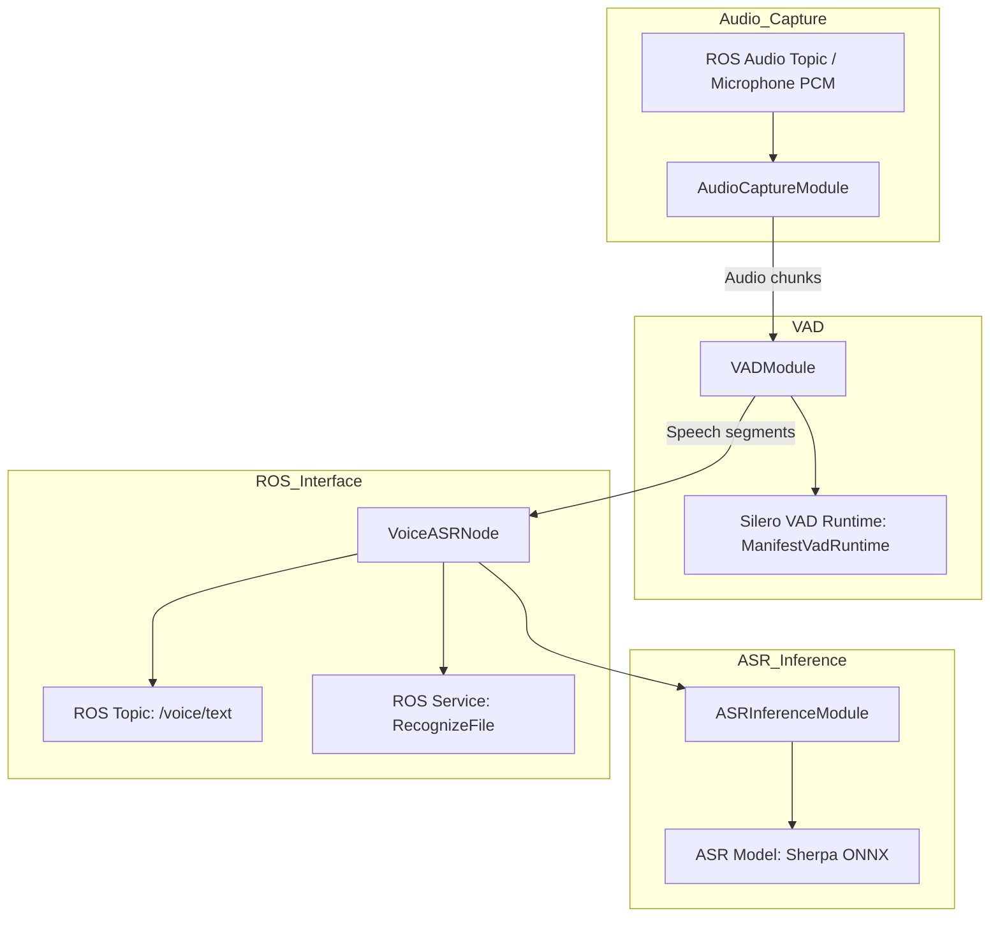
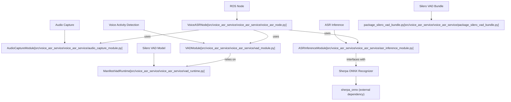

# ASR 与 VAD

相关源码文件

以下文件被用作生成此 wiki 页面的上下文：

- [.agents/skills/ibrobot-inference-verify/SKILL.md](https://atomgit.com/openeuler/IB_Robot/blob/openEuler-26.09/.agents/skills/ibrobot-inference-verify/SKILL.md)
- [.agents/skills/ibrobot-inference-verify/references/host.md](https://atomgit.com/openeuler/IB_Robot/blob/openEuler-26.09/.agents/skills/ibrobot-inference-verify/references/host.md)
- [docs/fullsubnet_310b_deployment.md](https://atomgit.com/openeuler/IB_Robot/blob/openEuler-26.09/docs/fullsubnet_310b_deployment.md)
- [scripts/verify_speech_direction_assets.py](https://atomgit.com/openeuler/IB_Robot/blob/openEuler-26.09/scripts/verify_speech_direction_assets.py)
- [src/voice_asr_service/README.md](https://atomgit.com/openeuler/IB_Robot/blob/openEuler-26.09/src/voice_asr_service/README.md)
- [src/voice_asr_service/test/speech_direction/test_model_sessions.py](https://atomgit.com/openeuler/IB_Robot/blob/openEuler-26.09/src/voice_asr_service/test/speech_direction/test_model_sessions.py)
- [src/voice_asr_service/test/test_audio_contract_validation.py](https://atomgit.com/openeuler/IB_Robot/blob/openEuler-26.09/src/voice_asr_service/test/test_audio_contract_validation.py)
- [src/voice_asr_service/test/test_package_fullsubnet_bundle.py](https://atomgit.com/openeuler/IB_Robot/blob/openEuler-26.09/src/voice_asr_service/test/test_package_fullsubnet_bundle.py)
- [src/voice_asr_service/test/test_package_silero_vad_bundle.py](https://atomgit.com/openeuler/IB_Robot/blob/openEuler-26.09/src/voice_asr_service/test/test_package_silero_vad_bundle.py)
- [src/voice_asr_service/voice_asr_service/asr_inference_module.py](https://atomgit.com/openeuler/IB_Robot/blob/openEuler-26.09/src/voice_asr_service/voice_asr_service/asr_inference_module.py)
- [src/voice_asr_service/voice_asr_service/audio_capture_module.py](https://atomgit.com/openeuler/IB_Robot/blob/openEuler-26.09/src/voice_asr_service/voice_asr_service/audio_capture_module.py)
- [src/voice_asr_service/voice_asr_service/defaults.py](https://atomgit.com/openeuler/IB_Robot/blob/openEuler-26.09/src/voice_asr_service/voice_asr_service/defaults.py)
- [src/voice_asr_service/voice_asr_service/package_fullsubnet_bundle.py](https://atomgit.com/openeuler/IB_Robot/blob/openEuler-26.09/src/voice_asr_service/voice_asr_service/package_fullsubnet_bundle.py)
- [src/voice_asr_service/voice_asr_service/package_silero_vad_bundle.py](https://atomgit.com/openeuler/IB_Robot/blob/openEuler-26.09/src/voice_asr_service/voice_asr_service/package_silero_vad_bundle.py)
- [src/voice_asr_service/voice_asr_service/speech_direction/model_sessions.py](https://atomgit.com/openeuler/IB_Robot/blob/openEuler-26.09/src/voice_asr_service/voice_asr_service/speech_direction/model_sessions.py)
- [src/voice_asr_service/voice_asr_service/vad_module.py](https://atomgit.com/openeuler/IB_Robot/blob/openEuler-26.09/src/voice_asr_service/voice_asr_service/vad_module.py)
- [src/voice_asr_service/voice_asr_service/voice_asr_node.py](https://atomgit.com/openeuler/IB_Robot/blob/openEuler-26.09/src/voice_asr_service/voice_asr_service/voice_asr_node.py)

本节详述 RoboFrame_stable 中 `voice_asr_service` ROS 2 包内的“ASR 与 VAD”子系统，聚焦 voice_asr_node、音频采集、语音活动检测（VAD）、自动语音识别（ASR）推理模块的运行时架构与实现，以及 Silero VAD bundle 的使用。

---

## 8.1.1 目的与范围

ASR 与 VAD 子系统负责：

- 实时或从文件采集音频。
- 检测语音活动以切分语音。
- 对切分后的音频执行 ASR 推理。
- 管理 Silero VAD 模型运行时与缓冲。
- 将这些组件集成到 ROS 2 节点（`VoiceASRNode`），通过 ROS topic 与 service 提供文本结果。

本叶子页面说明实现细节、模块职责、数据流、关键类与函数，以及 Silero VAD 模型 bundle 的用法。

---

## 8.1.2 系统组件与职责

### AudioCaptureModule

- 缓冲来自 ROS topic 的输入音频 PCM 消息。
- 为 VAD 维护 pre-roll 音频缓冲。
- 支持双通道采集：专用 VAD 通道与 ASR 通道。
- 为下游处理提供线程安全的音频分块访问。
- 管理音频采集状态：UNINITIALIZED、OPENING、CAPTURING、PAUSED、CLOSED、ERROR。

**关键类：** `AudioCaptureModule`  
**配置：** `AudioConfig(sample_rate=16000, channels=1, chunk_size=512, vad_input_channel=None)`  
**关键方法：**

- `feed_audio(data, channels)` 接收原始 PCM 字节或 numpy 数组。
- `get_audio_chunk()` 提供排队中的音频分块。
- `get_pre_roll_audio(seconds)` 取回缓冲的 pre-roll 音频。

---

### VADModule

- 对音频帧实现两级语音活动检测。
- 第一级：Silero VAD 深度学习模型，做粗粒度语音检测。
- 第二级：自适应能量阈值，做精细端点检测。
- 跟踪 VAD 状态迁移（`SILENCE`、`STARTING`、`SPEAKING`、`ENDING`）。
- 管理自适应噪声底校准与阈值。

**关键类：** `VADModule`  
**关键数据类：** `VADConfig`、`VADResult`、`VADState`  
**重要方法：**

- `set_runtime(runtime)` 附着一个已加载、由 Silero manifest 支撑的运行时。
- `process(audio_frame)` 处理音频帧并返回带语音存在性与置信度的 `VADResult`。
- 内部辅助函数负责能量计算、噪声底更新与状态机迁移。

---

### ASRInferenceModule

- 管理 Sherpa-ONNX 语音识别器的生命周期。
- 同时支持流式（在线）与离线识别模式。
- 支持热词以优先识别特定词条。
- 从 manifest 加载经过验证的 ASR 模型 bundle。
- 提供线程安全的音频流式输入与识别文本获取。

**关键类：** `ASRInferenceModule`  
**关键枚举：** `ASRState`、`ModelType`  
**关键数据类：** `ASRResult`  
**关键方法：**

- `initialize(bundle_path, deployment, language)` 加载并校验 ASR 模型。
- `recognize(audio_chunk)` 执行流式或离线识别。
- 支持流式重置与错误状态管理。

---

### voice_asr_node（ROS 2 节点）

- 集成音频采集、VAD 与 ASR 模块。
- 处理 ROS 参数声明与配置解析。
- 提供音频与识别文本的 ROS publisher/subscriber。
- 通过内部状态机（`NodeState`）协调采集与推理。
- 提供离线文件识别与热词设置服务。
- 定期执行状态心跳与音频停滞检测。

**关键类：** `VoiceASRNode`  
**关键特性：**

- 校验音频采样率与分块尺寸的兼容性。
- 处理前检查 ASR 就绪状态。
- 按需启动和停止音频采集。
- 发布中间部分结果与最终 ASR 结果。
- 管理 VAD 与 ASR 运行时生命周期。

---

### Silero VAD Bundle

- 以 schema-v3 推理 manifest 形式独立打包，包含多个部署：
  - `ascend_310p`：Ascend 310P OM 运行时。
  - `ascend_310b`：Ascend 310B OM 运行时变体。
  - `torch_cpu`：主机 CPU ONNX 运行时。
- 提供规范的 Silero VAD 模型用于语音检测。
- 供 ASR 流水线与语音方向应用共同使用。

**关键文件：** `package_silero_vad_bundle.py` 定义 bundle 结构与部署产物。  
**重要：** Bundle 包含用于运行时绑定的 adapter.json，并保证模型语义一致。

---

## 8.1.3 数据流与交互图

**说明：**

1. `AudioCaptureModule` 从 ROS 音频 topic 采集音频。
2. 音频分块送入 `VADModule`，后者使用 Silero VAD 运行时检测语音活动。
3. 检测到语音后，`VoiceASRNode` 触发 `ASRInferenceModule` 将音频段转写为文本，流式送入 Sherpa ONNX ASR 模型。
4. 识别文本发布到 ROS topic，并可通过 ROS 服务对离线文件进行识别。

来源：[src/voice_asr_service/voice_asr_service/audio_capture_module.py:12-186](https://atomgit.com/openeuler/IB_Robot/blob/openEuler-26.09/src/voice_asr_service/voice_asr_service/audio_capture_module.py#L12-L186), [src/voice_asr_service/voice_asr_service/vad_module.py:1-208](https://atomgit.com/openeuler/IB_Robot/blob/openEuler-26.09/src/voice_asr_service/voice_asr_service/vad_module.py#L1-L208), [src/voice_asr_service/voice_asr_service/asr_inference_module.py:1-193](https://atomgit.com/openeuler/IB_Robot/blob/openEuler-26.09/src/voice_asr_service/voice_asr_service/asr_inference_module.py#L1-L193), [src/voice_asr_service/voice_asr_service/voice_asr_node.py:1-175](https://atomgit.com/openeuler/IB_Robot/blob/openEuler-26.09/src/voice_asr_service/voice_asr_service/voice_asr_node.py#L1-L175)

---

## 8.1.4 VoiceASRNode 实现细节

### 初始化与参数

- 声明 ROS 2 参数，如 `active_mode`、`language`、`bundle_path`、`deployment`、`vad_bundle_path`、`vad_deployment`、`sample_rate`、`chunk_size`。
- 依据参数配置 ASR 与 VAD 运行时模块。
- 执行音频契约校验，确保采样率 = 16000 Hz、分块尺寸 = 512 采样点以保证兼容。

### 主要职责

- 用 `_state_machine` 管理状态并保证迁移合法。
- 提供“recognize_file” ROS 服务，支持带可选 VAD 的离线识别。
- 透明地启动/停止与暂停/恢复音频采集。
- 管理音频停滞：输入停滞超过 2 秒即停止采集。
- 在 ROS topic 上发布部分与最终识别结果。
- 在 ASR 流水线未就绪时提供错误处理与优雅恢复。

### 控制循环与音频处理

- 从 `AudioCaptureModule` 读取音频分块。
- 用 `VADModule` 对每个分块计算 VAD 结果。
- VAD 触发后，启动 ASR 流式识别或将分段排队。
- 流式识别状态异步更新。
- 汇总最终 ASR 文本并发布。

---

## 8.1.5 语音活动检测（VAD）算法细节

VAD 采用混合设计：

- **Silero VAD**：由 manifest 支撑的深度学习模型运行时（`ManifestVadRuntime`）对每 512 采样点的音频帧推断语音活动。
- **自适应能量阈值**：用动态校准的噪声底与能量门限补充 Silero 的语音概率输出。
- **状态机：**
  - SILENCE：无语音。
  - STARTING：疑似语音开始，容忍漏帧。
  - SPEAKING：当前语音活跃。
  - ENDING：检测到语音结束，等待最后几帧。

自适应阈值通过在静音帧期间对背景噪声校准，在嘈杂环境中调节语音检测灵敏度。

---

## 8.1.6 ASR 推理模块概览

- 封装 `sherpa_onnx` 识别器实例，支持流式或离线识别。
- 模型 bundle 从 schema-v3 manifest 加载，并校验兼容性（必须包含 encoder、decoder、joiner 或离线模型）。
- 支持热词表以偏置识别结果。
- 多线程安全，在音频帧上运行识别并做详细状态跟踪。
- 存在 encoder/decoder/joiner 时默认流式运行；否则为离线模式。
- 输出带置信度与时间戳的识别文本。

---

## 8.1.7 Silero VAD Bundle 打包

- Silero VAD 模型打包为带多个部署目标的 schema-v3 bundle。
- OM（离线模型）部署：`ascend_310p`、`ascend_310b`。
- 主机 CPU ONNX 部署：`torch_cpu`。
- 每个部署定义产物、执行契约、音频契约与张量绑定。
- 为推理运行时使用的输入/输出张量提供一致的语义标签。
- Bundle 是权威来源，供其他组件（包括语音方向）使用。

---

## 8.1.8 面向语音方向的执行会话适配器

除 VAD 与 ASR 之外，代码库还为语音方向模型定义了运行时会话适配器，使用 `SpeechDirectionRoleRunner` 统一调用 fullsubnet_fb/sb 与 silero_vad 等角色。

- `SpeechDirectionRoleRunner` 管理跨多次调用的受限执行上下文。
- 支持推理与状态重置操作。
- 在语音方向节点中用于增强的多通道音频处理。

---

## 8.1.9 代码实体关系图（自然语言到代码）

---

## 8.1.10 核心类及其职责汇总表

| 组件                | 关键类 / 文件                          | 职责                                                 |
|--------------------------|-----------------------------------------|----------------------------------------------------------------|
| 音频输入与缓冲  | `AudioCaptureModule` (audio_capture_module.py) | 采集、缓冲并管理 pre-roll 音频分块。          |
| 语音活动检测 | `VADModule` (vad_module.py)              | 使用 Silero VAD 与能量阈值检测语音存在。|
| ASR 推理            | `ASRInferenceModule` (asr_inference_module.py) | 以流式或离线模式运行 Sherpa ONNX 语音识别。 |
| ROS 2 节点               | `VoiceASRNode` (voice_asr_node.py)       | 管理集成、ROS 接口、音频采集、VAD、ASR 流水线。|
| Silero VAD 模型 Bundle  | `package_silero_vad_bundle.py`            | 定义规范的 Silero VAD 模型打包与部署。  |

---

## 参考与来源

- `src/voice_asr_service/voice_asr_service/audio_capture_module.py:1-186`
- `src/voice_asr_service/voice_asr_service/vad_module.py:1-208`
- `src/voice_asr_service/voice_asr_service/asr_inference_module.py:1-193`
- `src/voice_asr_service/voice_asr_service/voice_asr_node.py:1-175`
- `src/voice_asr_service/voice_asr_service/package_silero_vad_bundle.py:1-187`
- `src/voice_asr_service/voice_asr_service/speech_direction/model_sessions.py:1-149`
- `src/voice_asr_service/README.md:1-138`
- `src/voice_asr_service/test/speech_direction/test_model_sessions.py:1-178`
- `scripts/verify_speech_direction_assets.py:1-131`
