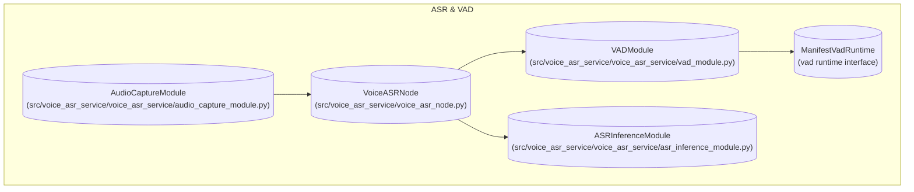
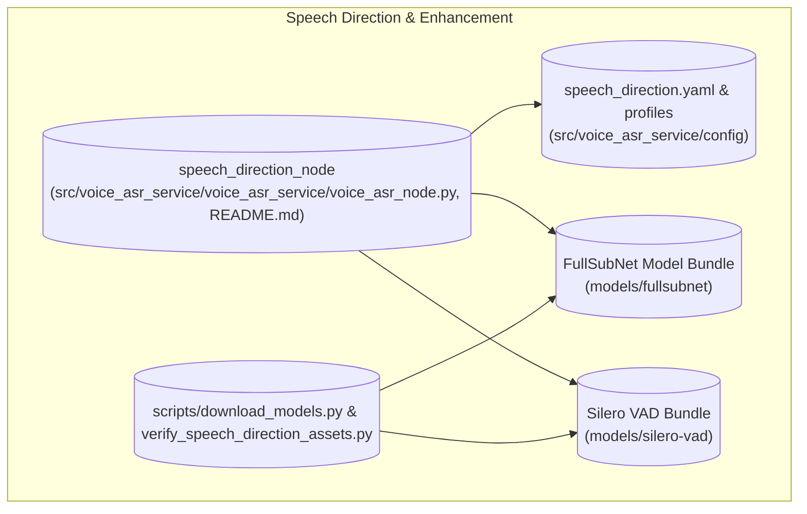

# 语音与音频概述

相关源码文件

以下文件被用作生成此 wiki 页面的上下文：

- [src/voice_asr_service/README.md](https://atomgit.com/openeuler/IB_Robot/blob/openEuler-26.09/src/voice_asr_service/README.md)
- [src/voice_asr_service/voice_asr_service/asr_inference_module.py](https://atomgit.com/openeuler/IB_Robot/blob/openEuler-26.09/src/voice_asr_service/voice_asr_service/asr_inference_module.py)
- [src/voice_asr_service/voice_asr_service/audio_capture_module.py](https://atomgit.com/openeuler/IB_Robot/blob/openEuler-26.09/src/voice_asr_service/voice_asr_service/audio_capture_module.py)
- [src/voice_asr_service/voice_asr_service/defaults.py](https://atomgit.com/openeuler/IB_Robot/blob/openEuler-26.09/src/voice_asr_service/voice_asr_service/defaults.py)
- [src/voice_asr_service/voice_asr_service/vad_module.py](https://atomgit.com/openeuler/IB_Robot/blob/openEuler-26.09/src/voice_asr_service/voice_asr_service/vad_module.py)
- [src/voice_asr_service/voice_asr_service/voice_asr_node.py](https://atomgit.com/openeuler/IB_Robot/blob/openEuler-26.09/src/voice_asr_service/voice_asr_service/voice_asr_node.py)

本节提供 RoboFrame_stable 中“语音与音频”子系统的高层概览，覆盖自动语音识别（ASR）、文本转语音（TTS）以及语音方向与增强的关键功能。这些组件共同使机器人能够感知语音命令、判定声源方向以促进交互，并生成合成语音进行交流。

由于本页是父级概览，详细的技术解释与实现细节委托给链接的子页面：

- [ASR 与 VAD](./asr_vad.md)
- [语音方向（DOA）与增强](./speech_direction_enhancement.md)
- [文本转语音](./text_speech.md)

---

## 8.1 自动语音识别（ASR）与语音活动检测（VAD）

ASR 子系统负责将采集的音频信号转换为文本表示。它集成语音活动检测（VAD）模块以稳健地识别语音段并过滤非语音音频。关键亮点包括：

- **VoiceASRNode**：编排音频采集、缓冲、VAD 与 ASR 推理的 ROS 2 节点，将识别出的文本以 ROS 话题或服务响应的形式发出。它支持实时流式识别与离线文件转写，并带状态管理与错误处理。
- **VADModule**：实现两阶段检测方法，将 Silero VAD（基于神经模型的语音概率估计）与基于能量的自适应阈值相结合，精确定位语音起点与终点，减少误报并捕获自然语音边界。
- **ASRInferenceModule**：管理 sherpa-onnx 识别器的生命周期，支持流式与离线模型类型、热词增强，并按部署 bundle 的 manifest 自动检测模型类型。它抽象了模型加载、音频流处理、解码与结果获取。

ASR 流水线强制严格的采样率（16 kHz）与帧大小（512 采样）以保持一致性。灵敏度、预滚缓冲时长与部署后端等可定制参数允许跨硬件配置适配。音频通过 AudioCaptureModule 从共享 ROS 音频话题缓冲 PCM 帧获取。

关于详细架构、节点 API 与配置，见 [ASR 与 VAD](./asr_vad.md)。

### ASR 与 VAD 的代码实体映射

来源：`src/voice_asr_service/voice_asr_service/voice_asr_node.py:1-175`, `src/voice_asr_service/voice_asr_service/vad_module.py:1-208`, `src/voice_asr_service/voice_asr_service/asr_inference_module.py:1-193`, `src/voice_asr_service/voice_asr_service/audio_capture_module.py:1-186`, `src/voice_asr_service/README.md:1-138`

---

## 8.2 语音方向（DOA）与增强

语音方向子系统估计输入语音信号的到达方向（DOA）并执行音频增强，以提升识别稳健性与抗噪能力。

- **speech_direction_node**：处理多通道麦克风阵列数据进行 DOA 估计与音频增强的独立 ROS 2 节点。它不执行 ASR 或底盘控制。该节点可通过 YAML 配置高度定制麦克风阵列布局、模型后端选择（如 Ascend 310P NPU 对比 CUDA CPU/GPU）以及角度分辨率与最大结果年龄等运行参数。
- **FullSubNet 增强模型**：增强模型（FullSubNet）增强多通道音频流以抑制噪声。它支持多种部署，如 Ascend NPU 优化的 OM 文件或 Torch CPU/GPU 运行时。
- **模型管理**：模型以带显式部署名的 schema-v3 bundle 组织。系统支持从 HuggingFace 仓库与 NAS 存储下载并校验模型资产。可启用诊断模式以存储中间音频与测量数据，用于离线分析与性能评估。

该子系统与由 ASR 包管理的共享 ROS 音频流水线交互，可独立启动或集成到 `sound_follow` 等更高层行为中。

关于详细用法、配置、部署与诊断，见 [语音方向（DOA）与增强](./speech_direction_enhancement.md)。

### 语音方向的代码实体映射

来源：`src/voice_asr_service/README.md:1-138`

---

## 8.3 文本转语音（TTS）

TTS 子系统从文本输入生成语音音频，使机器人能够以口头方式交流。

- **ZipVoice 适配器**：系统支持导出为 ONNX 或 Ascend 310P 优化运行时的 ZipVoice TTS 模型，在多样化平台上高效推理。
- **音频播放节点**：负责通过机器人扬声器播放合成音频的 ROS 节点，与 TTS 运行时服务集成。
- **Launch 与集成**：launch 文件与插件管理 TTS 服务、模型加载与音频播放的生命周期与互连，促成流畅的语音合成流水线。

关于包括支持的模型类型、播放集成与 launch 编排在内的全面说明，见 [文本转语音](./text_speech.md)。

---

## 架构小结

“语音与音频”子系统松耦合，但共享公共的音频输入流水线与模型资源管理。语音方向预处理提升信号质量与空间感知，将增强后的音频馈送给将其转换为文本的 ASR 子系统。TTS 子系统接收来自其他模块的文本命令或响应，并合成语音音频输出。

来源：`src/voice_asr_service/README.md:1-138`, `src/voice_asr_service/voice_asr_service/voice_asr_node.py:1-175`, `src/voice_asr_service/voice_asr_service/vad_module.py:1-208`, `src/voice_asr_service/voice_asr_service/asr_inference_module.py:1-193`, `src/voice_asr_service/voice_asr_service/audio_capture_module.py:1-186`

---

本概览定义了使 RoboFrame_stable 机器人跨支持硬件平台无缝感知、理解并响应语音输入的生态系统。

欲深入了解技术与运行细节，请参阅各子页面：

- [ASR 与 VAD](./asr_vad.md)
- [语音方向（DOA）与增强](./speech_direction_enhancement.md)
- [文本转语音](./text_speech.md)
