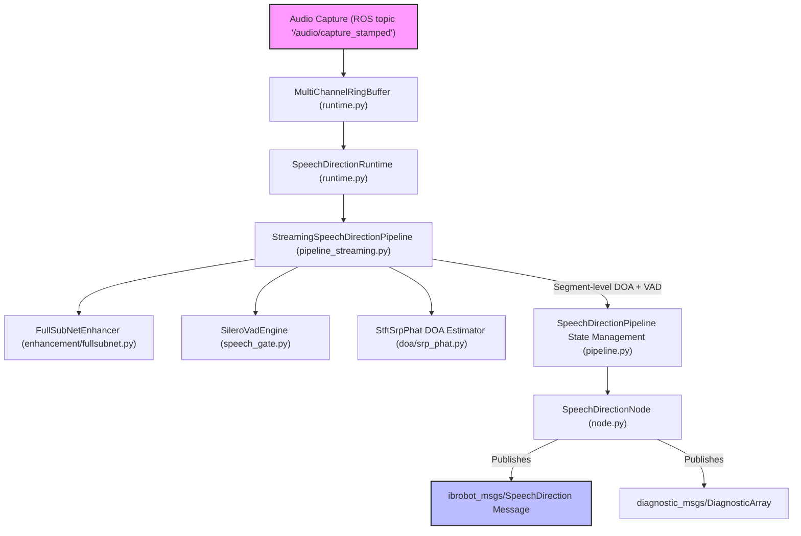
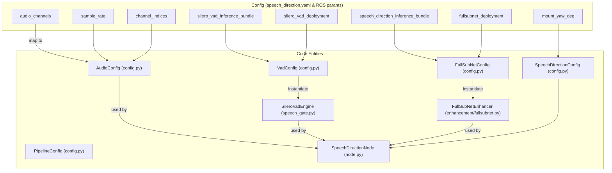

# 语音方向（DOA）与增强

<details>
<summary>相关源码文件</summary>

以下文件被用作生成此 wiki 页面的上下文：

- [scripts/download_speech_direction_models.sh](https://atomgit.com/openeuler/IB_Robot/blob/openEuler-26.09/scripts/download_speech_direction_models.sh)
- [src/robot_config/test/test_audio_io_launch_builder.py](https://atomgit.com/openeuler/IB_Robot/blob/openEuler-26.09/src/robot_config/test/test_audio_io_launch_builder.py)
- [src/voice_asr_service/config/speech_direction.yaml](https://atomgit.com/openeuler/IB_Robot/blob/openEuler-26.09/src/voice_asr_service/config/speech_direction.yaml)
- [src/voice_asr_service/launch/speech_direction.launch.py](https://atomgit.com/openeuler/IB_Robot/blob/openEuler-26.09/src/voice_asr_service/launch/speech_direction.launch.py)
- [src/voice_asr_service/test/speech_direction/test_offline_regression.py](https://atomgit.com/openeuler/IB_Robot/blob/openEuler-26.09/src/voice_asr_service/test/speech_direction/test_offline_regression.py)
- [src/voice_asr_service/voice_asr_service/speech_direction/config.py](https://atomgit.com/openeuler/IB_Robot/blob/openEuler-26.09/src/voice_asr_service/voice_asr_service/speech_direction/config.py)
- [src/voice_asr_service/voice_asr_service/speech_direction/enhancement/fullsubnet.py](https://atomgit.com/openeuler/IB_Robot/blob/openEuler-26.09/src/voice_asr_service/voice_asr_service/speech_direction/enhancement/fullsubnet.py)
- [src/voice_asr_service/voice_asr_service/speech_direction/enhancement/fullsubnet_stateful.py](https://atomgit.com/openeuler/IB_Robot/blob/openEuler-26.09/src/voice_asr_service/voice_asr_service/speech_direction/enhancement/fullsubnet_stateful.py)
- [src/voice_asr_service/voice_asr_service/speech_direction/model_downloader.py](https://atomgit.com/openeuler/IB_Robot/blob/openEuler-26.09/src/voice_asr_service/voice_asr_service/speech_direction/model_downloader.py)
- [src/voice_asr_service/voice_asr_service/speech_direction/node.py](https://atomgit.com/openeuler/IB_Robot/blob/openEuler-26.09/src/voice_asr_service/voice_asr_service/speech_direction/node.py)
- [src/voice_asr_service/voice_asr_service/speech_direction/runtime.py](https://atomgit.com/openeuler/IB_Robot/blob/openEuler-26.09/src/voice_asr_service/voice_asr_service/speech_direction/runtime.py)
- [src/voice_asr_service/voice_asr_service/speech_direction/speech_gate.py](https://atomgit.com/openeuler/IB_Robot/blob/openEuler-26.09/src/voice_asr_service/voice_asr_service/speech_direction/speech_gate.py)

</details>

本节详述 IB-Robot / RoboFrame 语音子系统中的 **speech_direction** 节点、配置、运行时与增强流水线。它覆盖到达方向（DOA）估计的设计与实现、基于 FullSubNet 的语音增强、流式推理流水线架构、运行时缓冲，以及模型资产管理（包括下载与校验），以支持健壮的跨平台部署。

---

## 目的与范围

语音方向与增强子系统提供健壮的多通道语音 DOA 估计，并结合神经语音增强，以支撑 ASR、远程呈现与人机交互能力。它包括：

- 一个集成音频采集、推理流水线与方向消息发布的 **speech_direction ROS 2 节点**。
- 结合 FullSubNet 神经增强与基于 SRP-PHAT 的 DOA 的流式流水线。
- 支持 Silero VAD 进行语音活动门控与分段级 DOA 边界。
- 用于大型模型资产自动下载与校验的模型管理工具。
- 用于实时音频流与离线测试的多消费者环形缓冲与运行时管理。

本页面描述关键代码组件、配置参数、数据流、运行时机制与建模资产。

---

## 1. speech_direction ROS 节点

### 概述

实现于 `src/voice_asr_service/voice_asr_service/speech_direction/node.py` 的 `speech_direction_node`：

- 加载参数：音频采样率、麦克风通道与位置、模型 bundle 路径、VAD 与增强后端、阵列安装角度偏移。
- 构造核心组件：FullSubNet 增强器、SileroVadEngine、SpeechGate（聚合 VAD + RMS）、StftSrpPhat 波束形成器，以及流式 SpeechDirectionPipeline。
- 运行定时器循环，以约 10Hz 轮询语音方向输出；发布与音频采样时间戳对齐的 `ibrobot_msgs/SpeechDirection` 消息。
- 处理从阵列坐标（度）到 REP-103 标准（弧度）的坐标转换。
- 实现优雅降级：若设备打开或模型加载失败，禁用发布但通过诊断报告（不崩溃）。
- 语音活动门控的分段级 DOA 发布：在语音开始时发出稳定的"start"方向，语音结束时发出最终方向，其余时间抑制输出。

### 关键类与流程

- `SpeechDirectionNode` —— 继承自 `rclpy.node.Node`，加载并校验参数，创建流水线与运行时实例，管理 ROS 发布器与定时器。
- `SpeechDirectionRuntime` —— 管理线程、音频缓冲馈送与推理调度。
- 构造用于 4 通道多通道增强的 `FullSubNetEnhancer`。
- 创建使用 `SileroVadEngine` 后端进行 VAD 的 `SpeechGate`。
- 使用 `StftSrpPhat` 波束形成算法从增强后音频估计 DOA。
- 聚合为集成增强、VAD 与 DOA 估计的 `SpeechDirectionPipeline`。

节点发布带有相应 header 时间戳与分段序列 ID 的 `SpeechDirection` 消息，由 VAD 与语音门检测到的语音分段触发。

---

## 2. 配置与参数

### 参数加载与校验

参数从 ROS 2 参数或 YAML 配置文件加载，并映射为结构化 dataclass。

- `SpeechDirectionConfig`（`src/voice_asr_service/voice_asr_service/speech_direction/config.py`）聚合所有配置域：

  - `AudioConfig`：通道数、采样率（固定 16 kHz）、通道索引。
  - `PipelineConfig`：帧大小、跳步大小、批处理与更新间隔。
  - `FullSubNetConfig`：checkpoint 路径、设备设置、后端选择。
  - `VadConfig`：Silero VAD 模型路径、后端、帧大小、输入通道。
  - `GrayRegionConfig`：控制软 VAD 门控与分段结束的参数。
  - `DoaConfig`：STFT 大小、跳步、麦克风位置、角度采样步长、频段等参数。
  - `DiagnosticsConfig`：高吞吐诊断控制标志。

- 严格类型检查强制参数类型正确且取值合理（如 sample_rate 必须为 16000、channel_indices 长度为 4、角度步长能整除 360）。

- 在 launch 文件（`src/voice_asr_service/launch/speech_direction.launch.py`）中，加载基础 YAML（`speech_direction.yaml`）并应用平台特定覆盖（`ascend_310p` 或 `ubuntu_cuda` 档案）。部署清单与后端校验以确保模型执行环境一致。

- 模型路径基于工作区根目录从相对路径展开为绝对路径。

### 默认配置要点（`speech_direction.yaml`）

- 音频话题默认为 `/audio/capture_stamped`
- 使用通道 `[1,2,3,4]` 进行 4 通道 DOA。
- `srp_update_interval_hops=2` 控制相对于模型跳步大小的 SRP-PHAT 更新速率。
- `angle_step_degree=5` 定义候选 DOA 角度分辨率（360° 上 72 个候选）。
- 麦克风物理位置定义边长约 4.57 cm 的方形阵列。
- Silero VAD 与 FullSubNet 的模型分别位于 `models/silero-vad` 与 `models/fullsubnet` 下。
- 控制保存原始/增强音频与指标的诊断标志，部署时默认禁用。

---

## 3. FullSubNet 语音增强

### 设计与实现

位于 `src/voice_asr_service/voice_asr_service/speech_direction/enhancement/fullsubnet.py` 的 `FullSubNetEnhancer` 类：

- 使用预训练 FullSubNet 模型实现 4 通道独立语音增强。
- 模型执行 STFT（固定 512 FFT、256 跳步、512 窗口），为每个通道输出压缩复比率掩码（cRM）。
- `decompress_cirm` 函数对 cRM 掩码执行逆压缩，获得应用于复频谱的复比率掩码，生成增强后的幅度与相位。
- ISTFT 重建增强后的时域波形。
- 增强器按通道分别调用模型进行独立去噪。

要点：

- 增强保持波形长度与输入完全一致。
- 增强后的信号保留 DOA 所需的空间相位关系。
- 设计与在 6 段真实录音上验证的回归基线完全一致（误差 ≤15°）。

### 增强数据流

```text
Audio 4-channel (T samples) ──► [enhance_4ch] ──► Enhanced 4-channel (T samples)
                 │
                 └───► per channel STFT → magnitude calc → FullSubNet Model (cRM) → decompress → enhanced spectrum → ISTFT
```

---

## 4. 语音方向流水线与运行时

### 基于 STFT-SRP-PHAT 的 DOA

`StftSrpPhat` 类实现 DOA 估计：

- 以大 STFT（frame=4096、hop=512、Hann 窗）处理增强后的多通道音频。
- 通过相位导向在候选角度上计算空间谱。
- 使用配置中的麦克风坐标与声速。
- 以最低分数阈值聚合帧，产生稳定的 DOA 估计。

### StreamingSpeechDirectionPipeline

- 以流式方式组合增强、基于 Silero VAD 的门控（`SpeechGate`）与 DOA 估计（`StftSrpPhat`）。
- 为分段级触发维护 VAD 与 DOA 状态。
- 提供推送音频块与获取分段 DOA 及语音活动事件的方法。

### 运行时：缓冲与线程

实现于 `src/voice_asr_service/voice_asr_service/speech_direction/runtime.py`：

- `MultiChannelRingBuffer`：
  - 线程安全的音频环形缓冲，将交织的 int16 音频存储为归一化 float32 数组。
  - 支持多个独立读者，带绝对采样计数以可靠引用帧。
  - 处理缓冲覆盖与丢弃，并准确记账。
  - 读取模式：阻塞（等待足够帧）或 latest（返回全部可用）。

- `SpeechDirectionRuntime`：
  - 管理工作线程，从环形缓冲轮询音频并运行流水线推理。
  - 提供 `feed_audio` API，从实时 ROS 话题回调或离线测试推送音频数据。
  - 处理优雅停止与状态同步。

speech_direction 节点使用该运行时在实时约束下进行健壮的流式处理。

---

## 5. 模型下载与校验

### 模型资产

- Silero VAD：
  - 语音活动检测模型。
  - CPU 基线（Ubuntu）使用 ONNX 格式。
  - 昇腾 NPU（310P）使用 OM 格式。
  - 位于 `models/silero-vad/assets/silero_vad.onnx`。

- FullSubNet：
  - 以累积有状态 checkpoint 训练的神经语音增强模型。
  - Ubuntu torch 后端使用 checkpoint `.tar`。
  - 昇腾后端使用 OM 部署工件（FB/SB/manifest）。
  - 位于 `models/fullsubnet/assets/cum_fullsubnet_best_model_218epochs.tar`。

### 自动模型下载脚本

- `scripts/download_speech_direction_models.sh`
  - 从公共 GitHub 源下载 Silero VAD ONNX（约 2.3MB）与 FullSubNet checkpoint（约 67MB）。
  - 覆盖前校验文件大小与 SHA-256。
  - 提供选择性选项，可单独下载任一模型。
  - 确保本地开发或 CI 回归所需的 Ubuntu CUDA 环境模型可用。

### 模型校验 API

- `src/voice_asr_service/voice_asr_service/speech_direction/model_downloader.py`
  - 提供 `require_configured_models` 函数。
  - 依据后端与部署校验模型存在性。
  - 资产缺失时抛出带提示信息的 `FileNotFoundError`。
  - 在节点启动时调用，强制模型就绪并防止静默失败。

---

## 6. 流式流水线与 SpeechDirectionNode 数据流

以下是连接 speech_direction 自然语言空间与关键代码实体的高层数据流 mermaid 图：



---

## 7. SpeechDirectionNode 与配置到代码的映射

此图展示 speech_direction 配置如何映射到相应代码组件：



---

## 摘要表：关键类与文件

| 组件                    | 描述                                                  | 文件与位置                                      |
|-----------------------------|--------------------------------------------------------------|-----------------------------------------------------|
| `SpeechDirectionNode`        | ROS 2 节点适配器、参数加载、发布器、定时器      | `src/voice_asr_service/voice_asr_service/speech_direction/node.py` [1-200](https://atomgit.com/openeuler/IB_Robot/blob/openEuler-26.09/src/voice_asr_service/voice_asr_service/speech_direction/node.py#L1-L200)               |
| `SpeechDirectionConfig`      | 配置参数的类型化 dataclass               | `src/voice_asr_service/voice_asr_service/speech_direction/config.py` [10-190](https://atomgit.com/openeuler/IB_Robot/blob/openEuler-26.09/src/voice_asr_service/voice_asr_service/speech_direction/config.py#L10-L190)             |
| `MultiChannelRingBuffer`     | 用于音频流的线程安全多消费者环形缓冲   | `src/voice_asr_service/voice_asr_service/speech_direction/runtime.py` [53-250](https://atomgit.com/openeuler/IB_Robot/blob/openEuler-26.09/src/voice_asr_service/voice_asr_service/speech_direction/runtime.py#L53-L250)            |
| `SpeechDirectionRuntime`     | 线程、缓冲、流水线执行管理                    | `src/voice_asr_service/voice_asr_service/speech_direction/runtime.py` [290-370](https://atomgit.com/openeuler/IB_Robot/blob/openEuler-26.09/src/voice_asr_service/voice_asr_service/speech_direction/runtime.py#L290-L370)           |
| `FullSubNetEnhancer`         | 使用预训练 FullSubNet 的 4 通道语音增强     | `src/voice_asr_service/voice_asr_service/speech_direction/enhancement/fullsubnet.py` [40-165](https://atomgit.com/openeuler/IB_Robot/blob/openEuler-26.09/src/voice_asr_service/voice_asr_service/speech_direction/enhancement/fullsubnet.py#L40-L165) |
| `SileroVadEngine`            | 带 LSTM 状态传播的 Silero VAD 实现        | `src/voice_asr_service/voice_asr_service/speech_direction/speech_gate.py` [30-200](https://atomgit.com/openeuler/IB_Robot/blob/openEuler-26.09/src/voice_asr_service/voice_asr_service/speech_direction/speech_gate.py#L30-L200)        |
| `StftSrpPhat`                | 基于经典相位变换的 SRP-PHAT DOA 估计       | `speech_direction/doa/srp_phat.py`                   |
| `StreamingSpeechDirectionPipeline` | 将增强、VAD 与 DOA 集成为流式流水线 | `src/voice_asr_service/voice_asr_service/speech_direction/pipeline_streaming.py` [40-100](https://atomgit.com/openeuler/IB_Robot/blob/openEuler-26.09/src/voice_asr_service/voice_asr_service/speech_direction/pipeline_streaming.py#L40-L100) |
| 模型下载与校验器  | 模型路径校验与文件存在性检查           | `src/voice_asr_service/voice_asr_service/speech_direction/model_downloader.py` [1-236](https://atomgit.com/openeuler/IB_Robot/blob/openEuler-26.09/src/voice_asr_service/voice_asr_service/speech_direction/model_downloader.py#L1-L236)    |
| 模型下载脚本        | 从 GitHub 或 CDN 拉取大型模型资产的脚本        | `scripts/download_speech_direction_models.sh`       |

---

## 参考与来源

- `src/voice_asr_service/voice_asr_service/speech_direction/node.py:1-179,200-250` - speech_direction ROS 2 节点实现、参数解析、运行时集成。
- `src/voice_asr_service/voice_asr_service/speech_direction/config.py:10-190` - 类型化配置 dataclass 与模型路径定义。
- `src/voice_asr_service/voice_asr_service/speech_direction/enhancement/fullsubnet.py:40-165` - FullSubNet 4 通道语音增强。
- `src/voice_asr_service/voice_asr_service/speech_direction/runtime.py:53-250,290-370` - MultiChannelRingBuffer 与运行时工作线程管理。
- `src/voice_asr_service/voice_asr_service/speech_direction/speech_gate.py:30-200` - Silero VAD 引擎与语音门控逻辑。
- `src/voice_asr_service/voice_asr_service/speech_direction/model_downloader.py:1-236` - 模型资产描述与校验。
- `launch/speech_direction.launch.py:0-168` - launch 文件与平台档案覆盖。
- `scripts/download_speech_direction_models.sh:1-182` - 模型下载与校验。

---

本页面整合了对语音方向与增强子系统的深入技术理解，便于维护、扩展和部署健壮的机器人听觉感知方案。
