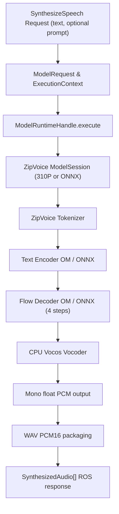
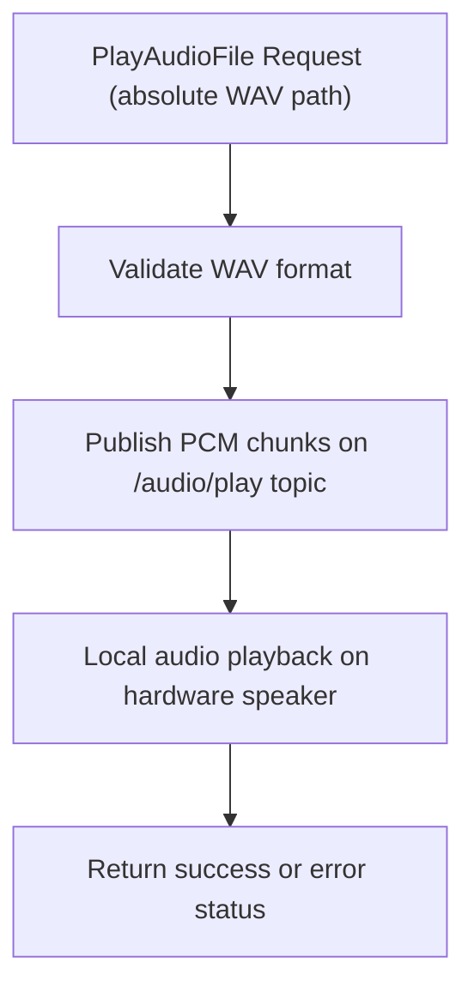
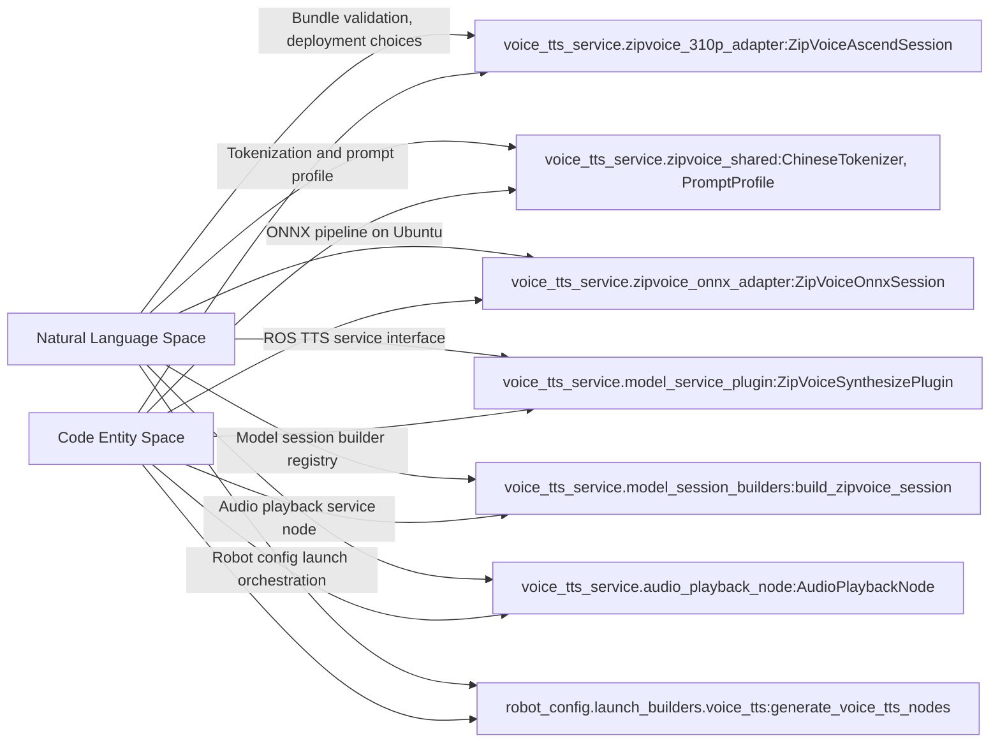
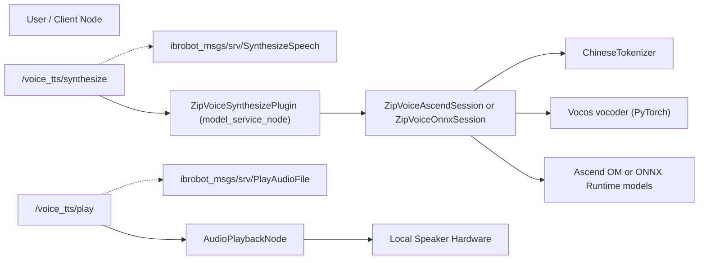

# 文本转语音

相关源码文件

以下文件被用作生成此 wiki 页面的上下文：

- [requirements/voice-tts.txt](https://atomgit.com/openeuler/IB_Robot/blob/openEuler-26.09/requirements/voice-tts.txt)
- [scripts/download_voice_tts_models.sh](https://atomgit.com/openeuler/IB_Robot/blob/openEuler-26.09/scripts/download_voice_tts_models.sh)
- [src/robot_config/robot_config/launch_builders/voice_tts.py](https://atomgit.com/openeuler/IB_Robot/blob/openEuler-26.09/src/robot_config/robot_config/launch_builders/voice_tts.py)
- [src/voice_tts_service/README.en.md](https://atomgit.com/openeuler/IB_Robot/blob/openEuler-26.09/src/voice_tts_service/README.en.md)
- [src/voice_tts_service/README.md](https://atomgit.com/openeuler/IB_Robot/blob/openEuler-26.09/src/voice_tts_service/README.md)
- [src/voice_tts_service/launch/voice_tts.launch.py](https://atomgit.com/openeuler/IB_Robot/blob/openEuler-26.09/src/voice_tts_service/launch/voice_tts.launch.py)
- [src/voice_tts_service/package.xml](https://atomgit.com/openeuler/IB_Robot/blob/openEuler-26.09/src/voice_tts_service/package.xml)
- [src/voice_tts_service/test/test_package_zipvoice_310p.py](https://atomgit.com/openeuler/IB_Robot/blob/openEuler-26.09/src/voice_tts_service/test/test_package_zipvoice_310p.py)
- [src/voice_tts_service/test/test_text_segmenter.py](https://atomgit.com/openeuler/IB_Robot/blob/openEuler-26.09/src/voice_tts_service/test/test_text_segmenter.py)
- [src/voice_tts_service/test/test_zipvoice_310p_adapter.py](https://atomgit.com/openeuler/IB_Robot/blob/openEuler-26.09/src/voice_tts_service/test/test_zipvoice_310p_adapter.py)
- [src/voice_tts_service/test/test_zipvoice_onnx_adapter.py](https://atomgit.com/openeuler/IB_Robot/blob/openEuler-26.09/src/voice_tts_service/test/test_zipvoice_onnx_adapter.py)
- [src/voice_tts_service/voice_tts_service/audio_playback_node.py](https://atomgit.com/openeuler/IB_Robot/blob/openEuler-26.09/src/voice_tts_service/voice_tts_service/audio_playback_node.py)
- [src/voice_tts_service/voice_tts_service/model_session_builders.py](https://atomgit.com/openeuler/IB_Robot/blob/openEuler-26.09/src/voice_tts_service/voice_tts_service/model_session_builders.py)
- [src/voice_tts_service/voice_tts_service/package_zipvoice_310p.py](https://atomgit.com/openeuler/IB_Robot/blob/openEuler-26.09/src/voice_tts_service/voice_tts_service/package_zipvoice_310p.py)
- [src/voice_tts_service/voice_tts_service/text_segmenter.py](https://atomgit.com/openeuler/IB_Robot/blob/openEuler-26.09/src/voice_tts_service/voice_tts_service/text_segmenter.py)
- [src/voice_tts_service/voice_tts_service/vocos_backend.py](https://atomgit.com/openeuler/IB_Robot/blob/openEuler-26.09/src/voice_tts_service/voice_tts_service/vocos_backend.py)
- [src/voice_tts_service/voice_tts_service/zipvoice_310p_adapter.py](https://atomgit.com/openeuler/IB_Robot/blob/openEuler-26.09/src/voice_tts_service/voice_tts_service/zipvoice_310p_adapter.py)
- [src/voice_tts_service/voice_tts_service/zipvoice_onnx_adapter.py](https://atomgit.com/openeuler/IB_Robot/blob/openEuler-26.09/src/voice_tts_service/voice_tts_service/zipvoice_onnx_adapter.py)
- [src/voice_tts_service/voice_tts_service/zipvoice_shared.py](https://atomgit.com/openeuler/IB_Robot/blob/openEuler-26.09/src/voice_tts_service/voice_tts_service/zipvoice_shared.py)

本节详述 RoboFrame 的**文本转语音（TTS）**子系统，重点介绍面向 Ascend 310P 与 ONNX 部署的 ZipVoice 模型适配器、音频播放节点、TTS launch 构建器以及模型服务插件。TTS 服务实现为 ROS 2 模型服务插件，处理文本到音频的转换与本地 WAV 播放，底层利用 ZipVoice TTS 模型。

---

## 目的与范围

TTS 子系统的目的在于提供：

- 统一的 ROS 2 语音合成服务接口。
- ZipVoice 模型 bundle 与部署的校验和管理。
- ZipVoice 流水线的运行时编排，包括 tokenizer、文本编码器、流解码器与声码器。
- 在暴露 ROS 2 播放服务的本地机器上播放合成的 WAV 文件。
- 通过 ZipVoice Ascend OM 流水线支持 Ascend 310P 硬件，通过 ONNX 运行时流水线支持 Ubuntu 主机。
- 对长输入进行有界文本分段并实施受控资源限制。
- 带错误处理与日志的稳定播放结果。

TTS 子系统**不**覆盖麦克风采集、ASR、对话管理、远程推理、后端回退或音频设备热插拔/混音。

---

## 1. ZipVoice 模型适配器

### 1.1 ZipVoice 310P（Ascend）适配器

- 实现于 `voice_tts_service/voice_tts_service/zipvoice_310p_adapter.py`。
- 类：`ZipVoiceAscendSession`（始于第 25 行）。
- 继承 `AscendOmModelSession`。
- 加载并校验为 Ascend 310P 或 Ascend 310B 硬件 SOC 配置的 ZipVoice bundle。
- 流水线包括：
  - 中文 tokenizer 的加载与校验。
  - 从含 token 与特征张量的 `.npz` 文件加载提示档案（prompt profile）。
  - 编排表示文本编码器与流解码器阶段的 Ascend OM 角色。
  - 使用基于 PyTorch 的 CPU 声码器（Vocos）。
- 对部署与 manifest 元数据强制严格运行时条件。
- 处理 `prompt_profile` 与设备选择等运行时选项。
- 实现主机端执行的多步欧拉积分流解码（经 4 步验证）。
- 支持基于张量的交互、按可配置容量对输入 token 分块，并返回以 16 位 WAV 编码的 PCM float 音频。

关键函数与细节：

- `_load_json()` 加载 ZipVoice 310P JSON 配置。
- `_asset(field)` 查询资产并确保路径安全。
- `_load()` 校验 manifest 并加载资源，卸载时延迟释放资产。
- `_load_assets()` 加载提示档案与 tokenizer。
- `_load_vocos()` 加载 CPU 声码器检查点并实例化。
- `_execute()` 运行文本编码器与流解码器角色的联合模型执行。
- 对畸形输入或不支持的提示抛出详细错误。

### 1.2 ZipVoice ONNX 适配器

- 实现于 `voice_tts_service/voice_tts_service/zipvoice_onnx_adapter.py`。
- 类：`ZipVoiceOnnxSession`（第 31 行）。
- 在无 Ascend 硬件的 Ubuntu 主机上使用 ONNX Runtime 实现流水线。
- 使用 `onnxruntime` 加载 ONNX 文本编码器与流解码器模型。
- 通过 `zipvoice_shared.py` 与 310P 适配器共享 tokenizer、提示档案与声码器逻辑。
- 类似地从 `.npz` 加载提示档案。
- 从 `vocos_backend.py` 加载声码器（基于 PyTorch）。
- 类似的输入/输出契约与迭代执行模型。

两个适配器的共同特性：

- 使用中文 tokenizer 类 `ChineseTokenizer`，借助 cn2an、jieba、pypinyin 进行词法处理。
- 提示档案 dataclass `PromptProfile`，内嵌用于语音克隆的 token 与特征张量。
- 用于拼接音频段的交叉淡入淡出拼接。
- 用于流解码器积分步的时间步调度。
- 错误处理：`BackendLoadError`、`BackendInferenceError`。
- 共享工具与错误语义从 `voice_tts_service.zipvoice_shared` 导入。

---

## 2. 音频播放节点

- 位于 `voice_tts_service/voice_tts_service/audio_playback_node.py`。
- 类：`AudioPlaybackNode`。
- 提供类型为 `ibrobot_msgs/srv/PlayAudioFile` 的 ROS 2 服务 `/voice_tts/play`。
- 服务接受本地 WAV 文件的绝对路径，并通过本地扬声器播放。
- 播放为同步：服务阻塞直至播放完成或超时。
- 在 ROS 音频话题（默认 `/audio/play`）上发布 PCM 数据块，供下游音频节点播放。
- 强制与 TTS 输出规格匹配的 WAV 格式校验（24 kHz、单声道、16 位小端）。
- 支持超时配置与稳定的错误报告（`PLAYER_NOT_READY`、`INVALID_TIMEOUT`、`PLAYBACK_TIMEOUT`）。

---

## 3. Launch 构建器

- 位于 `src/robot_config/robot_config/launch_builders/voice_tts.py`。
- 功能：
  - 依据机器人配置 YAML 中 `voice_tts` 键启用语音 TTS 节点。
  - 相对于全局 `WORKSPACE` 环境变量解析 bundle 路径。
  - 从 `voice_tts_service.defaults` 加载默认运行时选项。
  - 生成两个主要节点：
    - TTS 模型服务节点（`inference_service` 包，可执行 `model_service_node`），参数包括 bundle 路径、部署、适配器类（`ZipVoiceSynthesizePlugin`）与服务端点。
    - 音频播放节点（`voice_tts_service/audio_playback_node`），暴露播放 ROS 2 服务。
  - 强制机器人配置中启用音频 IO。
  - 可配置参数包括设备 ID、提示档案、分段限制、播放超时、采样率与音频通道数。

---

## 4. 模型服务插件与会话构建器

- 插件位于 `voice_tts_service/voice_tts_service/model_service_plugin.py`（摘录未展示，但由 launch 构建器隐含）。
- 插件封装 ZipVoice 模型会话并暴露 ROS 2 TTS 合成服务接口。
- 依据节点生命周期管理模型会话的加载与卸载。
- `ModelRuntimeHandle` 串行化访问，管理健康、取消与重载。
- 会话在节点生命周期内共享常驻，支持高效的重复请求。
- 使用 `build_zipvoice_session` 函数（`model_session_builders.py`）抽象后端选择：
  - 对带 ACL 运行时的 Ascend 后端返回 `ZipVoiceAscendSession`。
  - 对 CPU 上的 Torch/ONNX 后端返回 `ZipVoiceOnnxSession`。
- 注册函数 `register_zipvoice_session_builder` 将会话构建器与以模型身份（tensor_model/zipvoice/synthesize）为键的全局注册表绑定。

---

## 5. 数据流概览

### 文本合成流：

### 音频播放流：

---

## 6. 自然语言到代码实体的关联

### 系统组件到代码实体

### ROS 服务与消息到代码

---

## 7. 参数与配置

| 参数名           | 描述                                         | 默认值 / 来源                 |
|-------------------------|-----------------------------------------------------|---------------------------------|
| `voice_tts.bundle_path`  | ZipVoice 模型 bundle 路径                        | 由机器人 YAML 配置         |
| `voice_tts.deployment`  | 推理 manifest 内的命名部署       | 如 `ascend_310p`、`ubuntu_onnx` |
| `device_id`              | Ascend 硬件的目标设备 ID                 | `0`（默认）                   |
| `prompt_profile`         | 用于语音风格/克隆的命名提示档案        | `"default"`                     |
| `segment_max_chars`      | 每个文本段的最大字符数                  | 来自 `VOICE_TTS_DEFAULTS`       |
| `max_request_chars`      | 每次合成请求的最大总字符数      | 来自 `VOICE_TTS_DEFAULTS`       |
| `max_response_audio_bytes` | 合成音频响应的最大总字节数     | 来自 `VOICE_TTS_DEFAULTS`       |
| `playback_timeout_sec`   | 音频播放的最大超时                   | `300.0` 秒（默认）       |
| `audio_io.playback_topic`| 用于发布播放音频 PCM 的 ROS 话题          | `/audio/play`                   |
| `audio_io.playback_sample_rate` | 播放采样率                       | `24000` Hz                     |
| `audio_io.playback_channels` | 播放音频通道数                 | 1（单声道）                       |

---

## 8. 小结与说明

- TTS 子系统设计为托管于共享 `inference_service` 节点的模块化 ROS 2 服务插件。
- 同时支持 Ascend 310P OM 模型流水线与 Ubuntu 上原生 ONNX CPU 流水线。
- 模型会话抽象了资源加载、推理执行与清理。
- 音频播放解耦，使用带同步服务语义的 ROS 音频话题。
- 配置集中于机器人 YAML 文件；bundle 路径与部署相对于环境解析。
- 完整的校验与错误处理提升健壮性。
- 测试覆盖 tokenizer、适配器会话与分段器的正确性。

---

## 来源

- `src/voice_tts_service/voice_tts_service/zipvoice_310p_adapter.py:1-136`
- `src/voice_tts_service/voice_tts_service/zipvoice_onnx_adapter.py:1-146`
- `src/voice_tts_service/voice_tts_service/zipvoice_shared.py:1-180`
- `src/voice_tts_service/voice_tts_service/audio_playback_node.py:1-137`
- `src/robot_config/robot_config/launch_builders/voice_tts.py:1-124`
- `src/voice_tts_service/voice_tts_service/model_session_builders.py:1-71`
- `src/voice_tts_service/README.md:1-221`
- `src/voice_tts_service/README.en.md:1-163`
- `src/voice_tts_service/test/test_zipvoice_310p_adapter.py:1-166`
- `scripts/download_voice_tts_models.sh:1-171`
